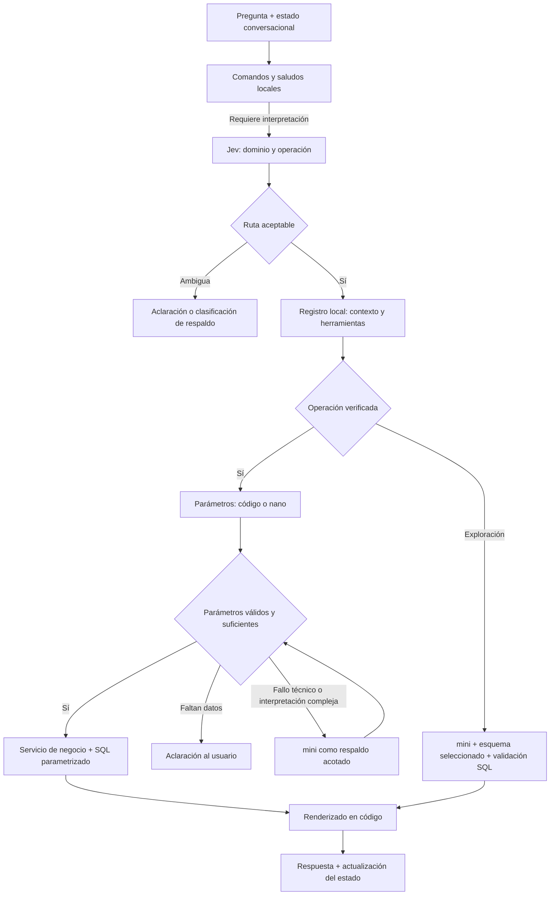

# Plan: contexto modular, enrutamiento con Jev y modelos por tarea

Fecha: 10 de noviembre de 2026. Estado: propuesta de implementación.

## Objetivo y alcance

Reducir el consumo y el costo por consulta cargando únicamente el contexto necesario
y asignando cada tarea a código, Jev, un modelo pequeño o un modelo de respaldo.
Conservar exactitud de negocio, continuidad conversacional y restricciones de SQL.

Este documento integra el diseño de modularización con una cascada de modelos.
No implica que Jev o gpt-4.1-nano estén integrados ni que se hayan medido sus ahorros.
La implementación será revisable por entregas; no incluye despliegue ni publicación
del entorno.

## 1. Referencia medida

El benchmark real del PR #20 está en [usage-live](../../usage-live/benchmark.json)
y sus eventos en [usage.jsonl](../../usage-live/usage.jsonl).

| Indicador | Resultado |
| --- | ---: |
| Consultas | 4 |
| Llamadas a gpt-4.1-mini | 7 |
| Tokens de entrada | 71,766 |
| Tokens de salida | 162 |
| Tokens totales | 71,928 |
| Tokens de entrada en caché, incluidos en entrada | 60,416 |
| Tiempo acumulado de llamadas al modelo | 6,234 ms |
| Tiempo acumulado de conversaciones | 6,266 ms |

Cada llamada llevó aproximadamente 10,000 tokens de entrada. El sistema aportó
37,942 caracteres y las herramientas 4,758 caracteres. Las instrucciones generales
ocuparon 18,624 caracteres y las reglas de negocio 16,635 caracteres.
Los caracteres por sección no equivalen a un desglose de tokens facturados.

La caché cubrió aproximadamente 84.2% de la entrada en esta ejecución. Por ello,
una reducción porcentual de tokens no equivale a la misma reducción de costo.
La muestra de cuatro consultas no representa todavía la distribución de producción.

## 2. Arquitectura y reparto de responsabilidades



El diagrama representa decisiones lógicas, no un bucle sin límite: cada respaldo
de interpretación podrá ejecutarse una sola vez por operación en la primera versión.

| Tarea | Ejecutor propuesto | Condición |
| --- | --- | --- |
| Saludos, ayuda y comandos | Código | Detección conservadora; una pregunta con saludo continúa al enrutador |
| Dominio y operación | Jev | Opciones cerradas del registro local |
| Parámetros ya presentes en estado o formatos inequívocos | Código | Validar vigencia y compatibilidad con la pregunta |
| Extracción de cliente, fechas y filtros | gpt-4.1-nano, candidato | Solo contexto y esquema de parámetros de la operación |
| Clasificación de respaldo | gpt-4.1-mini | Contexto breve de rutas, sin cargar todos los módulos |
| Interpretación compleja de parámetros | gpt-4.1-mini | Una escalada acotada; no sustituye datos faltantes |
| SQL exploratorio | gpt-4.1-mini inicialmente | Solo catálogo pertinente y restricciones actuales |
| SQL verificado, cálculo y presentación | Código | Consultas parametrizadas y plantillas existentes |

Jev y nano no duplicarán la misma clasificación. Jev seleccionará la operación;
nano extraerá parámetros cuando el código no pueda resolverlos. El registro local
determinará el ejecutor, sin dejar la elección de modelo al texto del usuario.

## 3. Inventario y modularización del contexto

Clasificar las instrucciones generales, reglas de negocio, catálogo y herramientas:

| Capa | Contenido | Carga |
| --- | --- | --- |
| Núcleo común | Seguridad, límites, herramientas, errores y restricciones obligatorias | Toda llamada que lo requiera |
| Dominio | Clientes/pagos, gastos, bancos, inventario o proveedores | Dominio seleccionado |
| Operación | Definición y reglas específicas | Operación seleccionada |
| Esquema | Tablas y columnas autorizadas | Solo las necesarias |
| Estado | Entidad, período, ruta y aclaración pendiente | Según continuidad |
| Evidencia | Resultados de herramientas necesarios | Solo rondas que la utilicen |

Entregables del inventario:

- Mapa de secciones, tamaños, duplicaciones y dependencias entre dominios.
- Núcleo común breve con reglas obligatorias identificadas explícitamente.
- Registro inicial de rutas y herramientas permitidas.
- Lista de reglas que deben ejecutarse en código en vez de depender del prompt.

El constructor no recortará silenciosamente reglas para cumplir un presupuesto.
Mantendrá bloques estables al inicio y datos variables después para favorecer caché.
Las restricciones de acceso y SQL seguirán aplicándose en código en todas las rutas.

## 4. Estructura propuesta

```text
src/dbagg/
  routing/
    contracts.py
    registry.py
    policy.py
    service.py
    providers/
      jev.py
  agent/
    context_builder.py
    templates/
      core.md
      domains/
        customers.md
        expenses.md
        banks.md
        inventory.md
        suppliers.md
      operations/
        ... instrucciones específicas ...
  llm/
    ... configuración y adaptadores existentes ...
  business/
    ... servicios existentes y nuevas operaciones verificadas ...
```

La ubicación definitiva se ajustará al inventario. Se reutilizarán los servicios,
adaptadores y configuración existentes; no se duplicará el cliente de OpenAI.
El registro asociará cada ruta con contexto, herramientas, esquema de parámetros,
ejecutor, tablas autorizadas, renderizador y versiones.

## 5. Contrato neutral de enrutamiento

Ejemplo de entrada interna:

```json
{
  "question": "¿Y cuánto ha pagado en total?",
  "conversation_state": {
    "previous_route": "clientes.saldo",
    "selected_customer_id": "DEMO1",
    "pending_clarification": null
  },
  "available_routes": [
    "clientes.saldo",
    "clientes.total_pagos",
    "gastos.total",
    "aclaracion",
    "fuera_de_alcance"
  ]
}
```

Ejemplo de decisión normalizada:

```json
{
  "route": "clientes.total_pagos",
  "confidence": 0.94,
  "provider": "jev"
}
```

Estos son contratos propuestos de dbagg, no formatos confirmados de la API de Jev.
El adaptador conservará las probabilidades disponibles sin inventar equivalencias
entre confianza declarada por distintos proveedores.

Empezar con una selección conjunta de dominio y operación. Evaluar una jerarquía
de dos decisiones solo si el número de rutas o los errores justifican otra llamada.

## 6. Integración con Jev

Verificar documentación oficial, acceso y autenticación, SDK/API, modelos vigentes,
tipos de preguntas, probabilidades, límites, concurrencia, tarifas y tratamiento
de datos. Referencia inicial:
[anuncio oficial](https://typesafe.ai/blog/introducing-system-one-models-and-jev) y
[documentación](https://docs.typesafe.ai/).

Implementar un adaptador sustituible con timeout, validación de rutas, reintentos
acotados, registro de errores y configuración de activación. La credencial se
configurará como secreto del entorno; no se guardará en Git.

Enviar pregunta, estado breve y opciones de ruta. No enviar por defecto el prompt
completo, SQL ni resultados de consultas. Seleccionar solo rutas habilitadas para
la configuración y permisos actuales.

La validez del tipo no garantiza que la ruta elegida sea correcta. Ajustar los
umbrales con casos de dbagg en español; no adoptar una cifra de confianza arbitraria.

## 7. Extracción con un modelo menor y cascada

Evaluar gpt-4.1-nano como candidato para extracción estructurada. Confirmar primero
disponibilidad en la cuenta, soporte de herramientas/salidas estructuradas y tarifas
vigentes. Mantener modelos configurables por tarea.

Entrada de extracción:

- Pregunta actual y estado relevante.
- Esquema cerrado de parámetros de la operación.
- Reglas necesarias de identificación y calendario.
- Opciones de entidades cuando exista una búsqueda local controlada.

Salida esperada: valores propuestos, campos faltantes y ambigüedades según el
contrato de la operación. Un identificador sugerido por el modelo siempre debe
resolverse y validarse contra datos autorizados antes de ejecutar SQL.

Ejemplo: para «pagos de Cliente Demo en octubre», extraer nombre y mes. Si el año
no está determinado por reglas o conversación, pedir aclaración; no escalar a un
modelo mayor esperando que invente el año.

Política inicial:

1. Resolver con código parámetros inequívocos o ya confirmados.
2. Usar nano cuando se necesite interpretación.
3. Validar estructura, operación, fechas, entidad y reglas de negocio.
4. Pedir aclaración ante información faltante u homónimos.
5. Escalar una vez a mini ante fallo técnico o interpretación compleja que pueda
   resolverse con la información disponible.
6. Si persiste el problema, devolver aclaración o error controlado.

No aceptar una confianza autodeclarada de nano como único criterio de ejecución.
Medir errores, respaldos y costo completo para decidir si nano es conveniente por
operación. Una operación puede mantenerse en mini si nano reduce la exactitud.

## 8. Registro de SQL y operaciones verificadas

| Ruta propuesta | Ejecución |
| --- | --- |
| clientes.saldo | Identificación y servicio de saldo existente |
| clientes.total_pagos | Servicio de pagos, estados y períodos existentes |
| gastos.total | Nueva operación con reglas de estados, importes y período verificadas |
| bancos.movimientos | Servicio bancario existente y validación de cuenta/período |
| exploracion.sql | mini con esquema acotado y validadores actuales |

Jev seleccionará identificadores registrados. El código mapeará esos identificadores
a funciones o scripts versionados. No se aceptarán rutas de archivo ni nombres de
ejecutores arbitrarios generados por el modelo.

Las operaciones verificadas usarán parámetros vinculados, permisos y límites
existentes. Los modelos no decidirán los permisos. La exploración conservará su
etiqueta de resultado exploratorio y las restricciones de SQL actuales.

## 9. Estado conversacional

Complementar la memoria existente con última ruta, entidad confirmada, período,
aclaración pendiente y versión. Actualizarlo tras resultados y selecciones válidas.
Invalidar elementos incompatibles al cambiar de dominio; `/reiniciar` limpiará
historial y estado.

Casos obligatorios:

| Secuencia | Comportamiento |
| --- | --- |
| Saldo de Cliente Demo → ¿y cuánto ha pagado? | Conservar cliente; cambiar operación |
| Pagos de octubre → ¿y septiembre? | Conservar entidad; cambiar período |
| Saldo de cliente → ahora los gastos | Cambiar dominio sin arrastrar filtros de cliente |
| Muéstrame sus movimientos, sin referente | Pedir aclaración |
| Saludo seguido de pregunta | Procesar la pregunta; no consumirla como saludo local |

Reducir el historial enviado solo después de comprobar que el estado conserva los
referentes necesarios. Considerar separación por conversación y seguridad ante
procesamiento concurrente.

## 10. Observabilidad y costo

Ampliar la correlación del PR #20 sin añadir contenido sensible a los logs de uso:

| Evento | Campos principales |
| --- | --- |
| routing | Proveedor, ruta, probabilidades disponibles, duración y resultado |
| context_selection | Módulos, versiones y tamaños |
| extraction | Modelo, validación, campos faltantes sin sus valores sensibles |
| fallback | Motivo, tarea origen y destino |
| usage | Consumo informado por proveedor y tarea |

Medir por consulta y ruta: llamadas, entrada normal, entrada en caché, salida,
duración, aclaraciones, errores, respaldos y costo estimado.

El costo incluirá Jev, nano, mini y todos los intentos observados. Usar tarifas
versionadas y fechadas por proveedor, modelo y clase de token. No tratar caché como
entrada normal ni campos desconocidos como cero. Distinguir estimación de factura.
Si Jev no informa consumo, documentar el método de estimación y sus límites.

## 11. Evaluación de calidad y ahorro

Comparar las siguientes variantes para aislar el efecto de cada cambio:

| Variante | Propósito |
| --- | --- |
| Flujo actual con mini | Referencia |
| Contexto modular, enrutador de referencia y mini | Medir modularización |
| Contexto modular, Jev y mini | Medir enrutamiento Jev |
| Contexto modular, Jev, nano y respaldo mini | Medir cascada completa |

Conservar las cuatro consultas actuales y ampliar con preguntas por dominio,
continuaciones, cambios de tema, errores ortográficos, homónimos, períodos
incompletos, preguntas mixtas, fuera de alcance y fallos de proveedores.

Separar casos de desarrollo/calibración de los casos finales de evaluación.
Usar rutas y parámetros esperados revisados, además de ejecutar consultas contra
datos sintéticos con respuestas conocidas. No usar solamente otro modelo como juez.

Repetir ejecuciones en condiciones comparables y reportar la caché observada;
no asumir que puede forzarse su estado. Medir precisión de ruta, exactitud de
parámetros, exactitud de respuesta, respaldo, latencia y costo por consulta correcta.

Criterios de aceptación:

- Pasar pruebas existentes y nuevas de rutas, continuidad, parámetros y fallos.
- Mantener restricciones de permisos y SQL en todos los ejecutores.
- No introducir regresiones en los casos críticos de negocio definidos.
- Mostrar el resultado de nano frente a mini por operación, con tamaño de muestra.
- Reducir costo total incluyendo respaldos, sin ocultar aclaraciones adicionales.
- Reducir contexto por llamada; objetivo inicial: al menos 50% en operaciones
  frecuentes frente a la referencia, pendiente de validación.
- Mantener comportamiento controlado con Jev deshabilitado o no disponible.

No sumar porcentajes de ahorro de cambios distintos. Medir la variante completa.

## 12. Entregas e implementación gradual

| Entrega | Trabajo | Resultado revisable |
| --- | --- | --- |
| 1. Inventario y contratos | Mapear prompt, rutas, parámetros y dependencias | Documento de módulos y contratos |
| 2. Contexto modular | Núcleo, clientes/pagos, gastos, constructor y selección de herramientas | Flujo modular usando mini como referencia |
| 3. Jev | Adaptador, configuración, política y respaldo | Pruebas de integración y evaluación de rutas |
| 4. Modelos por tarea | Perfil nano, extracción, validadores y escalada acotada | Comparativa nano/mini por operación |
| 5. Estado y SQL | Continuidad explícita y gastos como operación verificada | Casos completos del benchmark |
| 6. Evaluación real | Variantes, repeticiones, costo y latencia | HTML, gráficos y eventos antes/después |
| 7. Activación gradual | Configuración por dominio y modo de observación | Cambio reversible, preparado para revisión |

Comenzar con clientes/pagos y gastos. Ampliar a bancos, inventario y proveedores
después de validar contratos y continuidad.

En modo de observación, Jev propondrá rutas sin controlar la ejecución. Sus llamadas
tendrán costo y se contabilizarán. La extracción con nano podrá evaluarse inicialmente
fuera del flujo activo con casos sintéticos. Después, habilitar cada componente por
dominio con opciones independientes para volver a mini o al flujo anterior.

## 13. Configuración propuesta

Extender la configuración LLM existente con selección por tarea y banderas de
modularización, enrutamiento y observación. Nombres exactos pendientes del diseño:

- Perfil de enrutamiento: Jev o respaldo configurado.
- Perfil de extracción: nano o mini.
- Perfil de exploración: mini.
- Perfil de respaldo de interpretación: mini.
- Dominios habilitados y política de ambigüedad.
- Timeouts, límites de escalada y modo de observación.

Evitar cambiar globalmente el modelo actual para todas las tareas. Mantener la
compatibilidad con configuraciones existentes y documentar migración y reversión.

## 14. Riesgos y decisiones pendientes

| Riesgo o incógnita | Tratamiento |
| --- | --- |
| Acceso, límites o cambios de API de Jev | Confirmar antes del adaptador; interfaz neutral |
| Clasificación incorrecta pese a tipo válido | Evaluación en español, calibración y aclaración |
| Nano falla en fechas o referencias | Validación, pruebas por operación y respaldo acotado |
| Nueva llamada consume el ahorro | Medir costo y latencia de la cadena completa |
| Modularización reduce aciertos de caché | Prefijos estables y evaluación con caché observada |
| Contexto omitido cambia reglas de negocio | Inventario de dependencias y pruebas de resultados |
| Estado arrastra cliente o período incorrecto | Invalidación explícita y pruebas de cambios de tema |
| Preguntas de varios dominios | Aclarar/priorizar inicialmente; no ejecutar parcialmente sin explicarlo |

## 15. Definición de terminado

La entrega estará terminada cuando existan módulos versionados, un registro de
operaciones autorizadas, adaptador Jev sustituible, perfiles por tarea, validación
de parámetros, continuidad y respaldos acotados, con pruebas y un reporte comparativo
real que permita decidir qué operaciones usarán nano y cuáles conservarán mini.
Los resultados deben incluir errores y costos de intentos fallidos, instrucciones
de reproducción y configuración de reversión. Despliegue y publicación requieren
una instrucción posterior.
