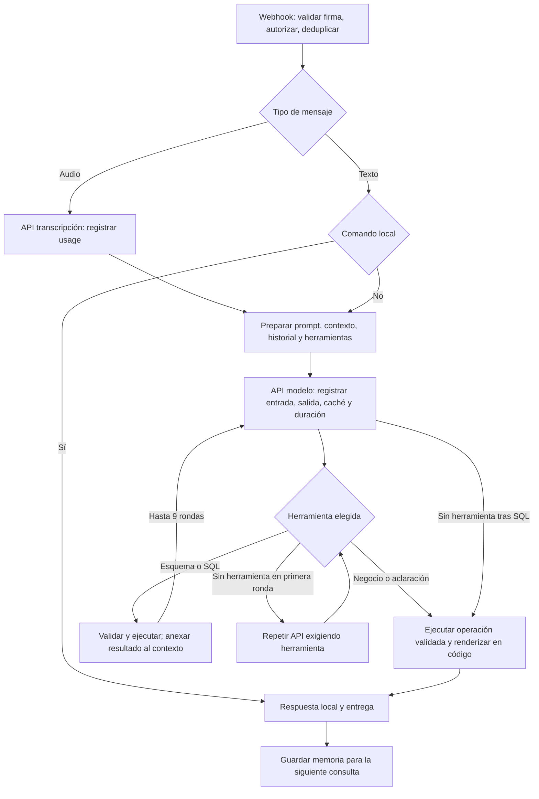

# Medición de tokens y etapas

Cada llamada de chat (OpenAI, GLM, Gemini, Anthropic y proveedores compatibles)
y cada transcripción escribe un evento JSONL en `data/usage.jsonl`.
`DBAGG_USAGE_PATH` permite seleccionar otra ruta. La medición está activa por defecto.
Configurar rotación y retención del archivo con las herramientas de operación del servidor.

Los eventos incluyen identificador aleatorio de mensaje, secuencia, modelo, proveedor,
duración y comienzo relativo, ronda, uso obligatorio de herramienta, herramienta anterior,
conteos de entrada/salida/total/caché/razonamiento/audio cuando se informan.
Las etapas locales se registran con el mismo identificador: preparación del prompt,
negocio, esquema, SQL, renderizado y entrega. Sus tiempos son intervalos inclusivos;
no sumar el tiempo de `answer` con el de las llamadas que contiene.
`Assistant.last_trace['usage']` incluye identificador, llamadas, llamadas con total
conocido y suma de los totales conocidos. Esa suma es parcial si faltan conteos.

No se registran teléfonos, contenido de preguntas/respuestas, SQL, audio ni claves.
Los tamaños de contexto se guardan como **caracteres**, por rol y por sección del sistema.
No constituyen un desglose de tokens facturados: la API no proporciona ese desglose.

## Interpretación

- `null` significa desconocido, nunca cero inferido.
- Los tokens de caché y de razonamiento ya forman parte de los totales de OpenAI.
- Anthropic informa entrada normal, lectura de caché y creación de caché por separado;
  se suman para normalizar la entrada total. No sumar nuevamente esos campos al total.
- La transcripción puede informar tokens o segundos. Se conserva la unidad informada.
- Se captura usage antes de validar la respuesta: un rechazo por protocolo también
  puede haber consumido tokens. Un error de red sin respuesta deja uso desconocido.
- Los reintentos internos de transporte no tienen un recibo de usage por intento.
  Los eventos representan invocaciones del adaptador y su respuesta final; no permiten
  reconstruir cargos de intentos que el proveedor no informa. El benchmark desactiva
  reintentos de transporte para facilitar la comparación.
- SQL, PDF, memoria y entrega no llaman al modelo. Los resultados SQL y el historial
  sí generan entrada cuando se reenvían al modelo en otra llamada.

## Pruebas reproducibles

Desde un checkout con las dependencias del proyecto instaladas:

```sh
# Configurar OPENAI_API_KEY en los secretos del entorno, sin escribirla en el comando.
# Permitir https://api.openai.com en la política de red.
.venv/bin/python scripts/benchmark_usage.py --output work/usage-live-001

# Verificación sin red: sus conteos son fixtures artificiales.
.venv/bin/python scripts/benchmark_usage.py --mock --output work/usage-mock-001

# Entorno con matplotlib instalado; genera HTML autónomo, SVG y PNG.
python scripts/plot_usage.py work/usage-live-001 work/usage-report
```

El benchmark usa `gpt-4.1-mini`, cuatro preguntas sintéticas y el servicio completo
de conversación; llama a la API del modelo en modo real y usa SQLite sintético como
base de datos. No envía mensajes de WhatsApp ni consulta datos de producción.
Incluye saludo, saldo, continuación con historial y exploración de gastos.
El modelo real puede elegir rutas diferentes; el reporte refleja las llamadas observadas.
Depende de las fixtures de `tests/`, por lo que se ejecuta desde el checkout, no desde una wheel.

Los artefactos incluyen `benchmark.json` y `usage.jsonl`. Se exige un directorio nuevo
para evitar mezclar resultados. Si falta la clave, termina con código 2 y estado `blocked`.

## Resultado de esta revisión

### Medición real del 10 de noviembre de 2026

Se ejecutaron las cuatro consultas contra la API de OpenAI con `gpt-4.1-mini`,
temperatura 0 y sin reintentos de transporte, usando únicamente SQLite sintético.
La ejecución final completó las cuatro respuestas sin errores de modelo ni de etapas:

| Consulta | Llamadas | Tokens totales |
| --- | ---: | ---: |
| Saludo / aclaración | 2 | 20,276 |
| Saldo del Cliente Demo | 1 | 10,212 |
| Total de pagos con historial | 1 | 10,267 |
| Gastos exploratorios | 3 | 31,173 |
| **Total** | **7** | **71,928** |

Entrada: 71,766 tokens; salida: 162; entrada en caché: 60,416 (incluida en entrada).
Las llamadas al modelo acumularon 6,234 ms; las conversaciones completas, 6,266 ms.
Son observaciones de una ejecución, no promedios de rendimiento ni un importe facturado.
El saludo requirió una segunda llamada para exigir herramienta; los gastos siguieron
la secuencia esquema → SQL → renderizado. Se comprobaron saldo 100, pagos 25 y gastos
activos 42, excluyendo el gasto cancelado de 999.

[Reporte real HTML](usage-live/reporte.html) · [Consumo real](usage-live/consumo.svg) ·
[Etapas reales](usage-live/etapas.svg) · [Eventos](usage-live/usage.jsonl) ·
[Resultados](usage-live/benchmark.json).
También se generan versiones PNG de consumo, etapas y flujo.

Dos intentos previos hicieron llamadas reales y fallaron en SQL porque la fixture de
gastos no tenía la columna ESTADO que requieren las reglas de negocio.
Sus eventos y resultados se conservan en `usage-live/attempts/`; no se incluyen en
los totales ni gráficos de la ejecución final. Se corrigió la fixture y el benchmark
ahora devuelve código 1 y `completed_with_errors` cuando falla cualquier etapa,
aunque las llamadas al proveedor hayan tenido éxito. Los estados de esos dos
manifiestos se corrigieron al revisar los eventos; contienen una nota explícita.

Validación: 564 pruebas unittest y `ruff check src tests scripts` aprobados.

### Ejemplo simulado anterior

Se verificaron cuatro mensajes con transporte HTTP simulado y seis respuestas del
proveedor: 1, 1, 1 y 3 llamadas respectivamente. **Los 1,050 tokens por llamada son
valores artificiales de prueba y no representan el consumo de gpt-4.1-mini.**
El tamaño de los mensajes enviados y los tiempos del proceso sí se observaron durante
esa ejecución local; los tiempos simulados no representan latencia de una API remota.

En la revisión inicial la prueba real estaba bloqueada por falta de clave y permiso
de red. Ese bloqueo quedó resuelto para la medición real documentada arriba.

[Reporte HTML](usage-example/reporte.html) · [Consumo](usage-example/consumo.svg) ·
[Etapas](usage-example/etapas.svg) · [Diagrama de flujo](usage-example/flujo.svg)


